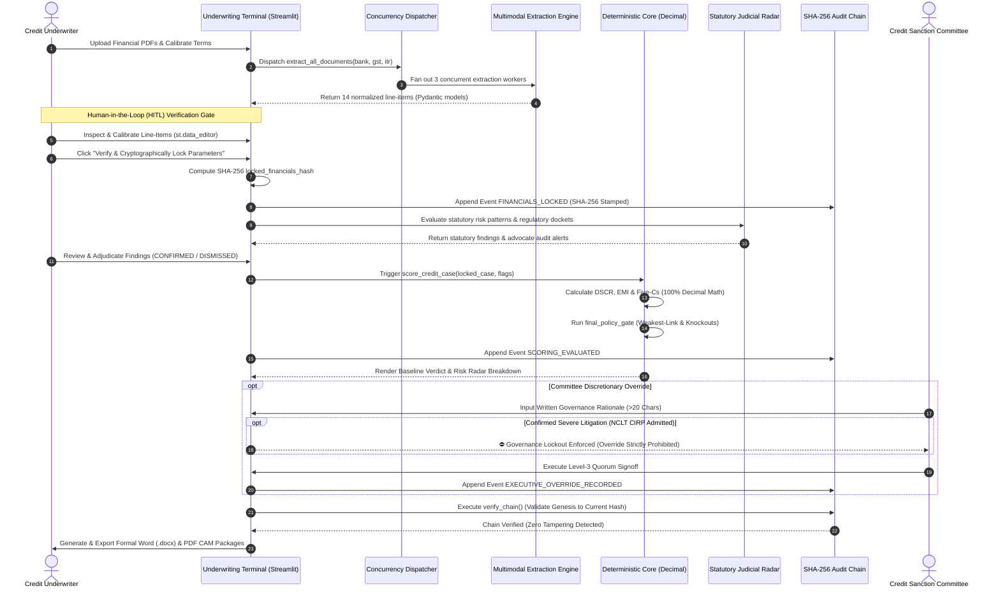

<div align="center">
  <h1>🛡️ CreditGate</h1>
  <p><b>MSME Credit Underwriting Copilot & Deterministic Risk Decision-Support System</b></p>

  <p>
    🔐 Licensed under <b>GNU AGPLv3</b> &nbsp;•&nbsp; 
    📌 Developed by <b>Sri Vighna Teja (Teja DVST)</b> | 2026<br/>
    🚀 <b>Live Deployment:</b> <a href="https://creditgate.streamlit.app/"><b>https://creditgate.streamlit.app/</b></a>
  </p>

  <div>
    <a href="https://creditgate.streamlit.app/"></a>
    <a href="https://github.com/SRIVIGHNATEJA/CreditGate/releases/tag/v1.0.0"></a>
    <a href="https://www.python.org/"></a>
    <a href="LICENSE"></a>
    <a href="https://docs.pydantic.dev/"></a>
    
    
    <a href="https://github.com/SRIVIGHNATEJA/CreditGate/actions"></a>
    <a href="https://docs.pytest.org/"></a>
  </div>

  <p>
    <a href="#-executive-overview"><b>Overview</b></a> &nbsp;•&nbsp;
    <a href="#-system-architecture"><b>Architecture</b></a> &nbsp;•&nbsp;
    <a href="#-systems-design--engineering-rationale"><b>Design Rationale</b></a> &nbsp;•&nbsp;
    <a href="#-core-financial-invariants--precision-math"><b>Financial Invariants</b></a> &nbsp;•&nbsp;
    <a href="#-benchmark-cohort-validation"><b>Benchmarks</b></a> &nbsp;•&nbsp;
    <a href="#-forensic-engineering--root-cause-analyses-rca"><b>Forensic RCA</b></a> &nbsp;•&nbsp;
    <a href="#-underwriting-copilot-workflow-4-stage-pipeline"><b>Workflow</b></a> &nbsp;•&nbsp;
    <a href="#-automated-verification-suite"><b>Test Suite</b></a> &nbsp;•&nbsp;
    <a href="#-author--contributions"><b>Author</b></a>
  </p>
</div>

---

<div align="center">

| ⚡ Appraisal Velocity | 🎯 Calculation Precision | ⚖️ Statutory Risk Radar | 🧪 Test Fortification | 🔐 Audit Provenance |
| :---: | :---: | :---: | :---: | :---: |
| **~35ms Extraction**<br/>*(Offline Deterministic Mode)* | **100% Python Decimal**<br/>*(0.00% Drift)* | **Fail-Closed Radar**<br/>*(Anti-Clean-Chit & CIRP)* | **114 / 114 Tests**<br/>*(100% Passing · 13.43s)* | **SHA-256**<br/>*(Chained Ledger)* |

</div>

---

> **The Challenge:** Commercial MSME credit appraisal takes 5 to 10 working days per borrower. Underwriters manually cross-reconcile hundreds of pages of bank statements, GSTR-3B filings, and ITR tax returns. Generic conversational LLMs hallucinate calculations, fail floating-point financial math, leak sensitive PII, and cannot satisfy Reserve Bank of India (RBI) regulatory explainability audits.
>
> **The Solution:** A decoupled underwriting copilot that uses multimodal AI strictly for document digitization and entity disambiguation, while delegating 100% of risk scoring, DSCR amortization, and credit committee policy gates to a deterministic, fixed-precision Python `Decimal` core protected by cryptographic SHA-256 audit chaining.

---

## 📋 Executive Overview

Engineered for commercial lending institutions, private credit desks, and NBFCs requiring strict regulatory compliance and reproducible credit sanction decisions:

| 🔒 **Deterministic Financial Precision & Math** | 🎯 **Cross-Document Forensic Triangulation** |
| :--- | :--- |
| Enforces 100% fixed-precision Python `Decimal` arithmetic for Debt-Service Coverage Ratios (DSCR), annuity EMI obligations, and Five-Cs weighted scoring—completely eliminating binary floating-point rounding drift ($0.1 + 0.2 \neq 0.3$). | Automatically reconciles taxable turnover (GSTR-3B) against annual bank deposits and ITR revenues, flagging circular trading, un-invoiced cash flows, and working capital accrual gaps ($>15\%$) across documents. |
| ⚖️ **Statutory Surveillance & Legal Risk Radar** | 🛡️ **Quorum Governance & Tamper-Evident Ledger** |
| Deterministic statutory pattern engine screening for **IBC 2016 CIRP insolvency (Sections 7/9/10)**, **Section 138 NI Act cheque dishonours**, and **DGGI tax notices** with a fail-closed **Anti-Clean-Chit framework** that flags unindexed firms for mandatory advocate audits (`PENDING_ADVOCATE_AUDIT`). | Implements Level-3 dual-signoff committee quorum (`DRAFT` $\to$ `CONCURRED` $\to$ `SANCTIONED`), binding all edits to an immutable SHA-256 hash-chained JSONL ledger and exporting formal `.docx` and `.pdf` CAM packages. |

---

<a id="-system-architecture"></a>
## 🏛️ System Architecture

CreditGate implements a decoupled, 5-stage pipeline that strictly isolates unconstrained multimodal document extraction from deterministic financial underwriting logic, statutory legal surveillance, and credit committee governance.

```mermaid
flowchart TD
    %% Styling Classes
    classDef intake fill:#F8FAFC,stroke:#64748B,stroke-width:1.5px,color:#0F172A;
    classDef engine fill:#F0FDFA,stroke:#0D9488,stroke-width:1.5px,color:#115E59;
    classDef gate fill:#FFFBEB,stroke:#D97706,stroke-width:2px,color:#92400E,font-weight:bold;
    classDef core fill:#EFF6FF,stroke:#2563EB,stroke-width:2px,color:#1E3A8A,font-weight:bold;
    classDef radar fill:#FAF5FF,stroke:#9333EA,stroke-width:1.5px,color:#581C87;
    classDef gov fill:#FEF2F2,stroke:#DC2626,stroke-width:2px,color:#991B1B,font-weight:bold;
    classDef export fill:#F0FDF4,stroke:#16A34A,stroke-width:2px,color:#14532D,font-weight:bold;
    classDef bridge fill:#F1F5F9,stroke:#475569,stroke-width:1.5px,stroke-dasharray: 4 2,color:#334155;

    subgraph Stage0 ["Stage 0: Borrower Intake & Facility Calibration (app_pages/case.py · core/onboarding.py)"]
        direction TB
        DOCS["<b>Unstructured Financial Dossiers (PDF)</b><br/>• Operative Bank Ledgers (12M Statements)<br/>• GSTR-3B Monthly Tax Returns<br/>• Audited ITR-6 Balance Sheets & P&L"]:::intake
        ONBOARD["<b>Statutory Corporate Intake</b><br/>• MCA-21 Corporate Registry (21-Char CIN)<br/>• Tax PAN Taxonomy (Char 'C' vs 'P'/'F')<br/>• Facility Calibration (Loan, Tenor, Rate, CGTMSE)"]:::intake
    end

    FANOUT(["<b>Concurrency Dispatcher:</b> core.parser: extract_all_documents<br/><i>ThreadPoolExecutor(max_workers=3) Parallel Fan-Out</i>"]):::bridge

    subgraph Stage1 ["Stage 1: Multi-Document Extraction & PII Redaction (core/parser.py)"]
        direction TB
        W_BANK["<b>Bank Statement Worker</b><br/>PyMuPDF Slicing (Max 3 Pages)<br/>PAN/Aadhaar Byte-Level Redaction"]:::engine
        W_GST["<b>GSTR-3B Summary Worker</b><br/>PyMuPDF Slicing (Max 2 Pages)<br/>PAN/Aadhaar Byte-Level Redaction"]:::engine
        W_ITR["<b>ITR Returns Worker</b><br/>PyMuPDF Slicing (Max 3 Pages)<br/>PAN/Aadhaar Byte-Level Redaction"]:::engine
        
        SLA{"<b>Engine Router & SLA Guard</b><br/>Persistent Worker Pool (max_workers=4)<br/><i>Strict 6.0s SLA Circuit Breaker</i>"}:::engine
        GEMINI["<b>Multimodal Vision AI</b><br/>Gemini 3.5 Flash Lite<br/>Structured Pydantic JSON Output"]:::engine
        FALLBACK["<b>Deterministic Regex Scraper</b><br/>Institutional Anchor Scraper<br/><i>Zero-API 5ms Fallback</i>"]:::engine
        RECON["<b>Bank Arithmetic Reconciler</b><br/>|Opening + Cr - Dr - Closing| < ₹1.00"]:::engine

        W_BANK --> SLA
        W_GST --> SLA
        W_ITR --> SLA
        SLA -- "API Key & SLA Satisfied" --> GEMINI --> RECON
        SLA -- "Timeout / Offline Mode" --> FALLBACK --> RECON
    end

    BRIDGE1(["<b>Raw Extraction Payload:</b> 14 Normalized Line-Items"]):::bridge

    subgraph Stage2 ["Stage 2: Forensic Triangulation & HITL Gate (app_pages/evidence.py)"]
        direction TB
        TRIANG["<b>Forensic Triangulation Engine</b><br/>• 3-Way Turnover Cross-Reconciliation<br/>• Accrual-to-Cash Horizon Gap (|GST - Bank| / max)<br/>• Mandate Bounce Counter & Narrative Scanner"]:::engine
        HITL{"<b>HITL Verification Gate</b><br/>Interactive st.data_editor<br/><i>Mandatory Non-Blank Validation</i>"}:::gate
        LOCK["<b>Cryptographic Lockout Seal</b><br/>CreditCase(officer_verified=True)<br/><i>SHA-256 locked_financials_hash</i>"]:::gate

        TRIANG --> HITL --> LOCK
    end

    BRIDGE2(["<b>Immutable Baseline Fingerprint:</b> locked_case Snapshot"]):::bridge

    subgraph Stage3 ["Stage 3: Legal Radar & Deterministic Decisioning (core/scorer.py · researcher.py)"]
        direction TB
        RADAR["<b>Statutory Risk Radar</b><br/>• Deterministic Pattern Matching (IBC, Sec 138, DGGI)<br/>• Watchlist Interceptor & Negative-Relief Guards<br/>• Fail-Closed Anti-Clean-Chit Framework"]:::radar
        ADJUDICATE{"<b>HITL Docket Review</b><br/>Officer Adjudication<br/><i>CONFIRMED / DISMISSED</i>"}:::radar
        SCORER["<b>Deterministic Five-Cs Engine</b><br/><i>100% Python Decimal Fixed Precision</i><br/>Character (20%) · Capacity (30%) · Capital (20%)<br/>Collateral (15% CGTMSE) · Conditions (15%)"]:::core
        POLICY["<b>Pure Policy Gate & Knockouts</b><br/>• Cutoffs: >=70 Approve, >=50 Conditional<br/>• Weakest-Link Ceiling (Operational < 40)<br/>• Hard Knockouts: DSCR < 1.20x, Bounces >= 5"]:::core
        VETO{"<b>Executive Override Modal</b><br/>Mandatory Written Justification<br/><i>⛔ Locked Out on Confirmed Insolvency</i>"}:::gov

        RADAR --> ADJUDICATE
        ADJUDICATE -- "Adjudicated Risk Flags" --> SCORER
        SCORER --> POLICY --> VETO
    end

    BRIDGE3(["<b>Sanction Posture:</b> Baseline vs Override Verdict"]):::bridge

    subgraph Stage4 ["Stage 4: Quorum Governance, Audit Ledger & CAM Export (core/cam_generator.py)"]
        direction TB
        QUORUM["<b>Level-3 Governance Quorum</b><br/>• Stage 1: Analyst Attestation<br/>• Stage 2: CRO Risk Concurrence & Covenants<br/>• Stage 3: Committee Sanction Resolution"]:::gov
        LEDGER["<b>Tamper-Evident SHA-256 Ledger</b><br/>Append-Only JSONL Event Stream<br/><i>Integrity Check: verify_chain()</i>"]:::export
        CAM_DOCX["<b>Formal Word CAM Package (.docx)</b><br/>Structured XML Shading · Natural Pagination"]:::export
        CAM_PDF["<b>Printable Sanction PDF (.pdf)</b><br/>ReportLab Official Seal · Sign-off Boxes"]:::export

        QUORUM --> LEDGER
        LEDGER --> CAM_DOCX
        LEDGER --> CAM_PDF
    end

    %% Pipeline Inter-Stage Transitions
    DOCS --> FANOUT
    FANOUT --> W_BANK
    FANOUT --> W_GST
    FANOUT --> W_ITR
    RECON --> BRIDGE1 --> TRIANG
    LOCK --> BRIDGE2 --> SCORER
    ONBOARD -- "Identity & Facility Calibration" --> SCORER
    ONBOARD -- "Borrower CIN & Legal Name" --> RADAR
    VETO --> BRIDGE3 --> QUORUM
```



---

### 🔄 Human-in-the-Loop Financial Verification & Quorum Sequence



---

<a id="-systems-design--engineering-rationale"></a>
## 💡 Systems Design & Engineering Rationale

Every architectural decision in CreditGate balances institutional regulatory compliance against execution speed, mathematical precision, and fraud prevention:

| Requirement / Challenge | Technical Implementation | Engineering & Regulatory Rationale |
| :--- | :--- | :--- |
| **Zero Math Hallucination** | **Pure Python `Decimal`** (`core/analyser.py`, `core/scorer.py`) | Generative LLMs and standard IEEE-754 floats introduce division rounding drift ($0.1 + 0.2 \neq 0.3$). Financial ratios (DSCR, EMI, weighted scores) must be 100% deterministic and legally reproducible for RBI audits. |
| **Separation of Extraction & Decision** | **Strict Pydantic V2 Schemas** (`core/data_models.py`) | LLMs are restricted strictly to structured text extraction. Credit scoring, risk weighting, and policy knockout gates are executed entirely by deterministic Python code without model discretion. |
| **Extraction SLA & Concurrency** | **Module-Level SLA Pool + 3-Worker Fan-Out** (`core/parser.py`) | Prevents network hangs and thread starvation. API calls run inside a persistent pool (`_GEMINI_EXECUTOR = ThreadPoolExecutor(max_workers=4)`) with a strict 6.0s timeout circuit breaker, backed by a 3-worker concurrency dispatcher (`max_workers=3`) for parallel Bank, GST, and ITR processing. |
| **Human-in-the-Loop Governance** | **Mandatory Cryptographic Lock** (`app_pages/evidence.py`) | Prevents automated pipeline execution on unverified OCR output. An underwriter must review and lock financial tables; any subsequent edits invalidate cached scores via composite state hashing (`compute_composite_hash`). |
| **Anti-Clean-Chit Surveillance** | **Fail-Closed Judicial Screening** (`core/researcher.py`) | Commercial entities unindexed in local registries are never granted an automated green "Clean Chit". They receive `PENDING_ADVOCATE_AUDIT`, mandating an empanelled advocate Title Search Report (TSR). |
| **Insolvency Lockout Rule** | **Immutable Governance Shield** (`app_pages/decision.py`) | Discretionary committee overrides are permanently disabled and stripped if an admitted `SEVERE` insolvency finding (e.g., NCLT Section 7/9/10 CIRP) is confirmed, preventing corrupt or rogue sanctions. |
| **Tamper-Evident Ledger** | **SHA-256 Hash Chaining** (`core/audit_logger.py`) | Maintains an unalterable chronological audit stream from genesis (`GENESIS`) to CAM export, satisfying internal model risk and Reserve Bank of India (RBI) compliance inspections. |
| **Mobile Layout Degradation** | **Custom Viewport Enforcer** (`ui/components.py: enforce_desktop_viewport_on_mobile`) | Overcomes Streamlit's native responsive column collapsing by programmatically injecting scaled viewport metas (`1280px` baseline), delivering full desktop multi-column fidelity on mobile. |
| **Autonomous Cloud Uptime** | **Headless Playwright Keep-Alive** (`.github/workflows/keep_alive.yml`) | Executes off-peak synthetic sessions (`23 1,9,17 * * *`), inspecting DOM state and resetting Streamlit Cloud sleep counters in $<35$ seconds without user intervention. |

---

<a id="-core-financial-invariants--precision-math"></a>
## 📐 Core Financial Invariants & Precision Math

### 1. Mathematical Formulas & Rounding Rules

* **Equated Monthly Installment (EMI):**

$$EMI = \frac{P \cdot r \cdot (1 + r)^n}{(1 + r)^n - 1}$$

  where $P = \text{Principal Loan Amount}$, $r = \frac{\text{Annual Interest Rate}}{12 \times 100}$, and $n = \text{Tenure in Months}$. Executed entirely in Python `Decimal` with `ROUND_HALF_UP`, quantized to 2 decimal places (`Decimal("0.01")`).

* **Debt-Service Coverage Ratio (DSCR):**

$$DSCR = \frac{\text{Operating Cash Flow (CADS)}}{\text{Total Annual Debt Service}} = \frac{\text{PAT} + \text{Depreciation} + \text{Interest Paid}}{\text{Existing Annual EMIs} + \text{Proposed Annual EMI}}$$

  *Zero Double-Counting Invariant:* Interest is added back to PAT + Depreciation in the numerator, while existing and proposed debt service are summed in the denominator. Quantized to 4 decimal places (`Decimal("0.0001")`, `ROUND_HALF_UP`). If Total Debt Service $\le 0$: returns `Decimal("Infinity")` if $\text{OCF} > 0$, `Decimal("0.00")` if $\text{OCF} = 0$, and `Decimal("-Infinity")` if $\text{OCF} < 0$. If $\text{OCF} \le 0$: returns `Decimal("0.00")`.

* **Bidirectional Accrual vs Cash Turnover Gap:**

$$\text{Gap Ratio} = \frac{|\text{GST Turnover} - \text{Bank Inward Credits}|}{\max(\text{GST Turnover}, \text{Bank Inward Credits})}$$

  Quantized to 4 decimal places (`Decimal("0.0001")`, `ROUND_HALF_UP`).

* **Debt-to-Equity (Capital Leverage):**

$$D/E = \frac{\text{Total Long-Term Debt}}{\text{Tangible Net Worth}}$$

  Quantized to 2 decimal places (`Decimal("0.01")`, `ROUND_HALF_UP`). If $\text{Net Worth} \le 0$, scores `0.0` points under `RULE_CAPITAL_INSOLVENT`.

### 2. Five-Cs Scoring Pillar Weights & Banded Lookups

$$\text{Composite Score} = \sum_{p \in \text{Pillars}} (\text{Score}_p \times \text{Weight}_p)$$

| Pillar | Weight | Metric / Basis | Pristine Threshold (100 Pts) | Knockout / Severe Floor |
| :--- | :---: | :--- | :--- | :--- |
| **Character** | **20%** | Cheque/Mandate Bounces, Operating Vintage, PAN Taxonomy | 0 Bounces in 12M, Vintage $\ge 3$ yrs, PAN matches MCA | $\ge 5$ Bounces $\to$ Auto-Reject; Vintage $<3$ yrs $\to -20$ pts |
| **Capacity** | **30%** | Debt-Service Coverage Ratio (DSCR) | $DSCR \ge 1.50\text{x}$ | $DSCR < 1.20\text{x} \to$ Hard Knockout (Auto-Reject) |
| **Capital** | **20%** | Debt-to-Equity (Gearing Ratio) | $D/E \le 1.00\text{x}$ | Net Worth $\le 0 \to 0.0$ pts (Technical Insolvency) |
| **Collateral** | **15%** | Tangible Security Coverage (CGTMSE-Aware) | Coverage $\ge 1.25\text{x}$ | CGTMSE Sovereign Floor: Floor applied at **75.0 pts** |
| **Conditions** | **15%** | Accrual-Cash Turnover Gap, Sectoral Risk | Turnover Gap $\le 15\%$ | Gap $> 30\% \to 30.0$ pts; High-Risk Sector $\to -15$ pts |

### 3. Bank Risk-Based Facility Pricing Matrix

Effective rate derives deterministically from the RBI Repo Benchmark (`6.50%`) plus credit risk spread:

| Score Band | Decision Verdict | Risk Tier | Base Spread | Effective Lending Rate |
| :--- | :--- | :--- | :---: | :---: |
| **$\ge 70.0$** | `APPROVE` | **Tier-1 Prime MSME** | $+3.75\%$ | **10.25%** |
| **$50.0 - 69.9$** | `CONDITIONAL` | **Tier-2 Moderate Risk** | $+5.00\%$ | **11.50%** |
| **$< 50.0$** | `REJECT` | **Tier-3 Stressed / Knockout** | $+7.25\%$ | **13.75%** *(or Declined)* |

---

<a id="-benchmark-cohort-validation"></a>
## 📊 Empirical Benchmarks & Cohort Validation

CreditGate is rigorously benchmarked across document extraction accuracy, arithmetic ledger reconciliation balance, and institutional credit policy sanction decisions:

### 1. Multimodal Extraction & Ledger Reconciliation Benchmark

Evaluated via the automated evaluation harness (`scripts/eval_harness.py`) across all 14 ground-truth financial line items per corporate dossier:

| Cohort Dossier | Verified Entity | Ground-Truth Fields | Extraction Accuracy | Bank Ledger Invariant | Parallel Latency (Offline Mode) |
| :--- | :--- | :---: | :---: | :---: | :---: |
| **`cohort_1_prime`** | Apex Synthetic Holdings (Demo) | 14 / 14 | **100.0%** | `BALANCED` ($\Delta < ₹1.00$) | **0.045s** |
| **`cohort_2_distressed`** | Kaveri Fictitious Freight (Demo) | 14 / 14 | **100.0%** | `BALANCED` ($\Delta < ₹1.00$) | **0.030s** |
| **`cohort_3_mismatch`** | Bharat Mock Steels & Infra (Demo) | 14 / 14 | **100.0%** | `BALANCED` ($\Delta < ₹1.00$) | **0.030s** |

```bash
# Run standalone 42-point extraction accuracy & arithmetic balance harness
python scripts/eval_harness.py
# Result: 100.00% accuracy (42/42 fields matched) · 0.035s mean parallel latency (Offline Deterministic Mode)
```

### 2. Institutional Underwriting Policy Cohort Validation

Evaluated under standard commercial facility terms (₹50.00 Lakhs @ 11.50% for 36 months, ₹25.00 Lakhs collateral, non-CGTMSE):

<div align="center">

| Benchmark Cohort | Ground-Truth Financial Profile | Forensic Signals | DSCR | Deciding Policy Rule | Final Sanction Verdict |
| :--- | :--- | :--- | :---: | :--- | :---: |
| **Cohort 1: Prime MSME**<br/>*(Apex Industrial Benchmark)* | • Turnover: ₹12.45 Cr<br/>• PAT: ₹1.20 Cr<br/>• Existing Debt: ₹1.80 Cr | Clean MCA RoC records<br/>0 cheque bounces<br/>Clean judicial dockets | **2.93x** | Baseline Five-Cs Weighted Score (**92.5 / 100**) | 🟢 **APPROVE** |
| **Cohort 2: Distressed**<br/>*(Kaveri Logistics Benchmark)* | • Turnover: ₹4.10 Cr<br/>• PAT: ₹1.20 Cr<br/>• Existing Debt: ₹3.20 Cr | 5 mandate cheque bounces<br/>Active NCLT Sec 9 CIRP<br/>High leverage (8.00x D/E) | **2.55x** | Policy Hard Knockout:<br/>`BOUNCE_KNOCKOUT` ($\ge 5$ bounces) · Score **62.5** | 🔴 **REJECT** |
| **Cohort 3: Mismatch Trap**<br/>*(Bharat Structural Benchmark)* | • Turnover: ₹4.50 Cr<br/>• PAT: ₹0.35 Cr<br/>• Existing Debt: ₹1.40 Cr | 48.9% GST-Bank turnover gap<br/>1 mandate bounce<br/>PAN Entity Mismatch ('F' vs 'C') | **1.56x** | Weakest-Link Cap:<br/>`CONDITIONS` pillar capped · Score **75.0** | 🟡 **CONDITIONAL** |

</div>

---

<a id="-forensic-engineering--root-cause-analyses-rca"></a>
## 🔍 Forensic Engineering & Root Cause Analyses (RCA)

Operationalizing enterprise credit underwriting software required diagnosing and resolving six concrete failure modes across mathematical, concurrency, UI, and policy boundaries:

### 1. Floating-Point Division Drift at Knockout Boundary &nbsp;<kbd>core/analyser.py</kbd>

| Stage | Technical Analysis |
| :--- | :--- |
| **Symptom** | A borrower with Operating Cash Flow of `₹1,980,000.00` and Total Debt Service of `₹1,650,000.00` evaluated to a DSCR of `1.1999999999999999x` under IEEE-754 binary floats, erroneously triggering the `DSCR < 1.20x` hard policy knockout. |
| **Root Cause** | Binary floating-point representation cannot represent fractional base-10 decimal values precisely in hardware memory. |
| **Remediation** | Implemented 100% of financial math across `core/analyser.py` using Python's fixed-precision `decimal.Decimal` with explicit `ROUND_HALF_UP` quantizing (`Decimal("0.0001")`). `Decimal('1980000') / Decimal('1650000')` evaluates cleanly to `1.2000x`, safely clearing the hurdle. |

### 2. ThreadPool Worker Architecture & Asynchronous SLA Timeout &nbsp;<kbd>core/parser.py</kbd>

| Stage | Technical Analysis |
| :--- | :--- |
| **Symptom** | When submitting multi-page documents concurrently, document extraction latency spiked and worker threads appeared to hang before rendering the verification grid. |
| **Root Cause** | Scoping `ThreadPoolExecutor` inside local functions via Python context managers (`with ThreadPoolExecutor()`) forced the runtime to block on `__exit__`, which invokes `shutdown(wait=True)`, waiting for slow external RPCs before releasing execution to the UI. |
| **Remediation** | Re-architected ingestion around a persistent module-level worker pool (`_GEMINI_EXECUTOR = ThreadPoolExecutor(max_workers=4, thread_name_prefix='gemini_sla_worker')`) with a strict 6.0s SLA circuit breaker, paired with a 3-worker concurrency dispatcher (`ThreadPoolExecutor(max_workers=3)`) for parallel document fan-out. |

### 3. Division-by-Zero & Infinite DSCR Sentinel Handling &nbsp;<kbd>core/analyser.py</kbd>

| Stage | Technical Analysis |
| :--- | :--- |
| **Symptom** | Applicants with zero debt service (debt-free borrowers) crashed the underwriting engine with unhandled `ZeroDivisionError` exceptions. |
| **Root Cause** | Naive division of operating cash flow by zero debt obligations without domain sentinel guards. |
| **Remediation** | Implemented defensive domain sentinels in `calculate_dscr`: if debt service $\le 0$ and $\text{OCF} > 0$, returns `Decimal("Infinity")` (earning full Capacity credit); if $\text{OCF} \le 0$, returns `Decimal("0.00")` (preventing negative ratios from breaking scoring bands). |

### 4. Discretionary Override Boundary Leak on Admitted Insolvency &nbsp;<kbd>app_pages/decision.py</kbd>

| Stage | Technical Analysis |
| :--- | :--- |
| **Symptom** | An officer could theoretically activate an executive override to sanction a loan even when the applicant had an admitted Corporate Insolvency Resolution Process (CIRP) order at NCLT. |
| **Root Cause** | The executive veto logic operated solely on the composite score without inspecting individual legal finding severity tiers. |
| **Remediation** | Implemented an immutable policy shield in `app_pages/decision.py`: if any finding marked as `FindingTier.SEVERE` is adjudicated as `ReviewStatus.CONFIRMED`, active overrides are automatically purged (`st.session_state.executive_override = None`) and veto controls are permanently locked out. |

### 5. Mobile Layout Column Collapse & Responsive Viewport Enforcer &nbsp;<kbd>ui/components.py</kbd> &nbsp;<kbd>app.py</kbd>

| Stage | Technical Analysis |
| :--- | :--- |
| **Symptom** | Accessing the Streamlit dashboard on mobile devices collapsed multi-column underwriting matrices into stacked vertical blocks, causing awkward label wrapping and broken tables. |
| **Root Cause** | Streamlit's native responsive CSS breakpoint forces all `st.columns` to stack vertically at viewport widths $< 768\text{px}$. |
| **Remediation** | Created `enforce_desktop_viewport_on_mobile(1280)` in `ui/components.py`. Injects a two-step JavaScript viewport meta override into `window.top.document` that forces mobile browsers to render at a scaled `1280px` desktop layout width without reflow flicker. |

### 6. CommonMark 4-Space Indentation Trap in Markdown HTML &nbsp;<kbd>ui/components.py</kbd>

| Stage | Technical Analysis |
| :--- | :--- |
| **Symptom** | Multiline HTML component strings passed to `st.markdown(..., unsafe_allow_html=True)` intermittently rendered as raw plaintext code blocks instead of styled HTML widgets. |
| **Root Cause** | CommonMark specifications interpret any line indented by 4 or more spaces, or preceded by blank lines, as a `<pre><code>` block. |
| **Remediation** | Routed all raw HTML rendering through `_clean_html(raw_html)`, which strips leading whitespace from every line and removes blank lines, guaranteeing zero CommonMark code block traps across all components. |

---

<a id="-underwriting-copilot-workflow-4-stage-pipeline"></a>
## 💻 Underwriting Copilot Workflow (4-Stage Pipeline)

CreditGate divides commercial MSME credit appraisal into four sequential, auditable operational stages:

| Stage | Domain & Scope | Verified Operational Invariants |
| :---: | :--- | :--- |
| <kbd>STAGE 01</kbd> | **Case Onboarding & Terms Calibration**<br/>`app_pages/case.py` · `core/onboarding.py` | • Validates 21-character MCA-21 Corporate Identification Number (CIN) syntax<br/>• Checks 4th-character PAN tax taxonomy (Company `C` vs Proprietor `P` vs Partnership `F`)<br/>• Auto-classifies NIC-2008 sector codes and calibrates proposed facility terms (Principal, Rate, Tenure, CGTMSE coverage) |
| <kbd>STAGE 02</kbd> | **Document Extraction & Forensic Triangulation**<br/>`app_pages/evidence.py` · `core/parser.py` | • Parallel multimodal ingestion across 12-month Bank Statements, GSTR-3B filings, and ITR forms<br/>• Reconciles accrual turnover vs bank credits, detecting un-invoiced cash flows and circular trading<br/>• Mandates underwriter review and cryptographic parameter locking (`locked_financials_hash`) |
| <kbd>STAGE 03</kbd> | **Deterministic Five Cs & Legal Radar**<br/>`app_pages/decision.py` · `core/scorer.py` | • Evaluates Character, Capacity, Capital, Collateral, and Conditions via 100% Decimal math<br/>• Screens statutory dockets (NCLT CIRP, Sec 138 NI Act, DGGI summons) with 1-click legal citations<br/>• Enforces weakest-link pillar floors, policy knockouts, and CIRP executive override lockout shields |
| <kbd>STAGE 04</kbd> | **Formal Word & PDF CAM Export**<br/>`app_pages/cam_audit.py` · `core/cam_generator.py` | • Compiles complete Credit Appraisal Memoranda compliant with commercial banking committee standards<br/>• Generates styled Microsoft Word (`.docx`) and printable PDF (`.pdf`) appraisal packages<br/>• Verifies chronological audit integrity via append-only SHA-256 hash-chained JSONL event stream |

---

<a id="-automated-verification-suite"></a>
## 🧪 Automated Verification Suite

The repository includes a standalone **114-test regression suite** across `tests/` (113 tests) and `scripts/test_phase3_onboarding_hitl.py` (1 test), verifying financial precision, statutory surveillance, policy knockouts, and headless UI flows:

| Test Domain | Tests | Verified Behavior & System Invariants |
| :--- | :---: | :--- |
| **Deterministic Financial Math & Scoring** | **22** | Banking annuity EMI, DSCR without interest double-counting, zero-debt-service sentinels, Indian Lakh/Crore grouping, safe divide, and CGTMSE collateral floor (`>= 75.0`). |
| **Statutory Surveillance & Legal Radar** | **21** | MCA-21 CIN syntax, 4th-character PAN entity taxonomy, `SEVERE` vs. `REVIEW` vs. `NEGATIVE_RELIEF` docket classification, and `PENDING_ADVOCATE_AUDIT` Anti-Clean-Chit guards. |
| **Policy Knockouts & Governance Rules** | **23** | `DSCR < 1.20x` and `Bounces >= 5` knockouts, `< 40.0` operational pillar caps, `INSUFFICIENT_DATA` missing-field routing, and CIRP override lockout rules. |
| **CAM Export & Cryptographic Ledger** | **22** | SHA-256 hash chaining (`verify_chain()` tamper detection), PII masking, HTML XSS escaping, Level-3 committee quorum states, and `.docx` / `.pdf` compilation. |
| **Headless UI, State & Layout Guards** | **26** | Multi-page `AppTest` navigation across all 3 cohorts, `compute_composite_hash` stale-score invalidation, CommonMark HTML sanitization, and theme compliance. |

```bash
# Execute full 114-test verification suite in virtual environment
.venv/bin/pytest -v
# Output: 114 passed, 7 warnings in 13.43s (100% Passing)
```

---

<a id="-quickstart--reproduction"></a>
## 🚀 Quickstart & Reproduction

```bash
# 1. Clone & Setup Python Virtual Environment
git clone https://github.com/SRIVIGHNATEJA/CreditGate.git
cd CreditGate
python3 -m venv .venv && source .venv/bin/activate

# 2. Install Production Dependencies
pip install -r requirements.txt

# 3. Configure API Credentials (Optional — Default runs via deterministic offline parser & cohort dockets)
export GOOGLE_API_KEY="your_gemini_api_key_here"

# 4. Run Full 114-Test Verification Suite
pytest -v

# 5. Launch Underwriting Copilot Terminal
streamlit run app.py
```

*The terminal will launch and bind automatically to `http://localhost:8501`.*

---

## 📁 Repository Structure

```text
CreditGate/
├── app.py                            # Master application entry point, multi-page routing & theme injection
├── requirements.txt                  # Pinned core runtime dependencies (Streamlit, PyMuPDF, Pydantic, ReportLab)
├── LICENSE                           # GNU Affero General Public License Version 3 (AGPL-3.0)
├── README.md                         # Architecture, empirical benchmarks & systems documentation
│
├── core/
│   ├── analyser.py                   # Banking annuity EMI, DSCR math, turnover gap, and safe division (Decimal)
│   ├── audit_logger.py               # Append-only SHA-256 event chaining logger & tamper verification
│   ├── cam_generator.py              # Credit Appraisal Memorandum generator (Markdown, Word .docx, PDF)
│   ├── config.py                     # API key resolution, model configuration, and credit policy constants
│   ├── data_models.py                # Pydantic V2 extraction models (Bank, GST, ITR, Case) & currency coercer
│   ├── formatting.py                 # Indian currency numbering formatter (format_inr) with Lakh/Crore grouping
│   ├── onboarding.py                 # MCA-21 CIN parser, PAN syntax/consistency validator & app ID generator
│   ├── parser.py                     # PyMuPDF page slicing, PII redaction, Gemini extraction & fallback regexes
│   ├── policy.py                     # Policy thresholds, Five-Cs weights, banded lookups & facility pricing
│   ├── researcher.py                 # Statutory risk pattern matcher (IBC CIRP, Sec 138, DGGI) & Anti-Clean-Chit engine
│   └── scorer.py                     # Five-Cs risk scoring engine, auditable deductions & final policy gate
│
├── ui/
│   ├── components.py                 # Calm Institutional UI components & mobile viewport enforcer
│   ├── state.py                      # Streamlit session state initialization, composite hash & sidebar
│   └── upload_modal.py               # Manual document upload dialog (@st.dialog) & instant entity sync
│
├── app_pages/
│   ├── case.py                       # Stage 1: Case intake, borrower profile & facility terms calibration
│   ├── evidence.py                   # Stage 2: Evidence ingestion, forensic triangulation & HITL lock
│   ├── decision.py                   # Stage 3: Five-Cs scorecard, legal radar & executive override controls
│   └── cam_audit.py                  # Stage 4: Sanction summary, Word/PDF export & audit ledger viewer
│
├── data/
│   └── synthetic/                    # 3 Golden benchmark cohorts with PDFs and ground-truth JSON files
│
├── templates/                        # Jinja2 HTML templates for synthetic bank, GST, and ITR documents
├── scripts/                          # Automated benchmarking harness & synthetic PDF generator
└── tests/                            # 114-test regression suite covering math, policy, and UI contracts
```

---

## 📜 Licensing & Compliance

This project is licensed under the **GNU Affero General Public License v3.0 (AGPL-3.0)** — see the [LICENSE](LICENSE) file for complete details.

*   **Source Code Licensing:** Governed by GNU AGPL-3.0 to maintain strict compliance with downstream document intelligence libraries (including PyMuPDF).
*   **Decoupled Upstream Architecture:** The extraction engine is decoupled via Pydantic schemas, enabling commercial deployments to switch to permissive OCR backends without altering core financial scoring or governance logic.
*   **Data Protection & PII:** Operates with byte-level text redaction on selectable PDF layers, ensuring unmasked PAN, Aadhaar, and account identifiers are never leaked to external logs or audit payloads.

---

<a id="-author--contributions"></a>
## 👤 Author & Contributions

**D. Sri Vighna Teja (`Teja DVST`)** — Hyderabad, India

- 📄 **Technical Focus:** Deterministic AI guardrails, financial decision-support systems, auditable document pipelines, and edge ML engineering.
- 🌐 **Portfolio:** [srivighnateja.vercel.app](https://srivighnateja.vercel.app)
- 💻 **GitHub:** [github.com/SRIVIGHNATEJA](https://github.com/SRIVIGHNATEJA)
- 💼 **LinkedIn:** [linkedin.com/in/srivighnateja](https://www.linkedin.com/in/srivighnateja)
- 🆔 **ORCID:** [0009-0009-8611-2292](https://orcid.org/0009-0009-8611-2292)
- 🎓 **Google Scholar:** [scholar.google.com/citations?user=C6qgWiMAAAAJ](https://scholar.google.com/citations?user=C6qgWiMAAAAJ&hl=en)

---

<div align="center">
  <i>Built with focus on deterministic financial engineering, regulatory auditability, and human-in-the-loop AI governance.</i>
</div>
