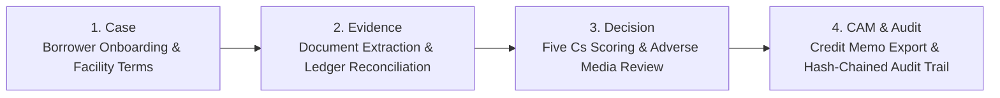

# CreditGate

CreditGate is an AI-assisted MSME credit underwriting copilot and deterministic risk assessment engine. It processes borrower financial documents (Bank Statements, GSTR-3B filings, and ITR forms), validates ledger math in fixed-precision `Decimal` arithmetic, scores applicants across the Five Cs of credit, and screens adverse media under human-in-the-loop (HITL) governance.

---

## Architecture & Data Flow



---

## How to Run

### 1. Environment Setup
```bash
python3 -m venv .venv
source .venv/bin/activate
pip install -r requirements.txt
```

### 2. Run Test Suite & Accuracy Harness
```bash
# Run automated test suite (62 tests across integrity, math, UI, and policy)
pytest -q

# Run extraction evaluation regression harness
python scripts/eval_harness.py
```

### 3. Launch Streamlit Application
```bash
streamlit run app.py
```
Open `http://localhost:8501` in your browser.

---

## Demo Walkthrough & Expected Real Verdicts

The application provides three built-in demo cohorts with deterministic outcomes:

### Cohort 1: Prime MSME (`Apex Synthetic Holdings (Demo)`)
- **Profile**: Revenue ₹10.40 Cr, PAT ₹0.85 Cr, Debt ₹1.20 Cr, DSCR 1.62x, 0 cheque bounces, clean adverse media.
- **Demo Path**: Select Cohort 1 on the **Case** page -> Review & Lock financial grid on **Evidence** -> Evaluate on **Decision** page.
- **Expected Real Verdict**: **`APPROVE`** (Composite Score: **96.3 / 100**, All 5 Cs above the 40-point floor).

### Cohort 2: Distressed Fleet (`Kaveri Fictitious Freight (Demo)`)
- **Profile**: Revenue ₹6.20 Cr, Debt ₹3.10 Cr, DSCR 0.88x, 5 cheque bounces, active NCLT Section 9 filing.
- **Demo Path**: Select Cohort 2 -> Lock financial grid -> Observe immediate policy knockout.
- **Expected Real Verdict**: **`REJECT`** (Deciding Rule: **`BOUNCE_KNOCKOUT`** due to 5 mandate bounces; composite score: **66.3 / 100**).
- *Adverse Media*: Surfaces an unreviewed NCLT insolvency hit. Confirming the finding with a court docket note reinforces rejection.

### Cohort 3: Turnover Variance & Low Margins (`Bharat Mock Steels & Infra (Demo)`)
- **Profile**: Revenue ₹14.80 Cr, PAT ₹0.18 Cr, Debt ₹4.50 Cr, DSCR 1.04x, 12.5% GST-Bank gap, 1 bounce, GST tax demand notice.
- **Demo Path**: Select Cohort 3 -> Lock financials -> Review Five Cs breakdown and adverse media.
- **Expected Real Verdict**: **`CONDITIONAL`** (Deciding Rule: **`WEAKEST_LINK_CAP`** due to 12.5% GST-Bank gap capping Conditions pillar at 35.0, below the 40.0 floor; composite score: **81.8 / 100**).

---

## Project Limitations & Disclaimers

> [!IMPORTANT]
> Please review the following technical, regulatory, and architectural boundaries of this demonstration:

1. **Synthetic Demo Data**: All applicant profiles, tax identifiers (PAN, GSTIN), bank statements, and court docket numbers are entirely synthetic fixtures generated for demonstration purposes.
2. **Illustrative Policy Rules**: Scoring bands, deduction weights (20/30/20/15/15), and thresholds (e.g., 40-point weakest link floor, DSCR cutoff of 1.25x) are illustrative engineering models, not official Reserve Bank of India (RBI) rules or credit policy committee rules.
3. **CGTMSE 75-Point Collateral Floor**: The CGTMSE 75-point collateral floor is an illustrative assumption for simulation purposes, not an actual statutory guarantee specification.
4. **Regex News Classification with Mandatory Review**: Adverse media news classification uses deterministic regular expressions with mandatory officer review. Regex patterns cannot interpret nuanced legal outcomes (e.g., an admitted petition vs. one dismissed with costs). Findings are surfaced strictly as `UNREVIEWED` recommendations and require mandatory credit officer review.
5. **Screening is Not Legal Verification**: The screening pipeline checks keyword patterns against indexed public sources. Adverse-media screening is not legal verification, and a "clean" or "no adverse media" finding does not constitute formal legal clearance or title verification.
6. **Digital Text PDFs Only**: Digital text PDFs only; other formats (e.g., scanned documents, images, or non-standard layouts) may return incomplete extraction and route to `INSUFFICIENT_DATA`.
7. **Tamper-Evident, Not Tamper-Proof Audit**: The audit log is hash-chained (tamper-evident, not tamper-proof). Modifications break the hash chain verified via `verify_chain()`, but this is not an append-only distributed ledger.
8. **Scoped PII Redaction**: PII redaction covers PAN/Aadhaar patterns in text PDFs only. It does not redact unstructured names, addresses, or metadata outside these patterns.
9. **NOT for Real Borrower Data**: NOT for real borrower data (no consent flow, retention rules, privacy notice or India-hosted storage). Do not upload live borrower or proprietary financial data.
10. **Export Formats**: CAM is Markdown/HTML. Direct `.docx` or PDF binary compilation is intentionally avoided to eliminate system-level dependencies.
11. **Offline Extraction by Default**: Extraction in the demo is the offline parser; Gemini path implemented but not live-tested (unless proven with live credentials).
12. **Live Search Testing**: Live Tavily not tested in the automated offline evaluation suite.
13. **Evaluation Harness Scope**: The 42/42 eval is a regression test on the project's own templates, not AI accuracy across arbitrary bank formats.
