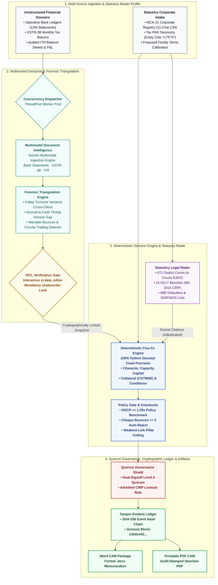
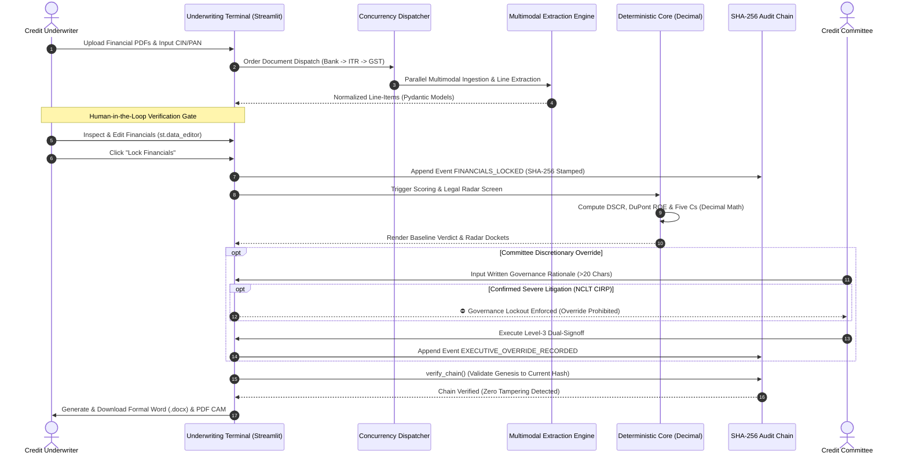

# 🛡️ CreditGate
**Enterprise MSME Underwriting Copilot & Deterministic Risk Decision-Support System**

> 🔐 Licensed under **Apache License 2.0**  
> 📌 Developed by **Sri Vighna Teja** | 2026 | Portfolio Project  
> 🚀 **Live Production Application:** [creditgate.streamlit.app](https://creditgate.streamlit.app)

<div align="center">

  [](https://creditgate.streamlit.app)
  [](https://github.com/SRIVIGHNATEJA/CreditGate/releases/tag/v1.0.0)
  [](https://www.python.org/)
  [](https://docs.pydantic.dev/)
  [](https://docs.python.org/3/library/decimal.html)
  [](https://en.wikipedia.org/wiki/Cryptographic_hash_function)
  [](https://github.com/SRIVIGHNATEJA/CreditGate/actions)
  [](https://docs.pytest.org/)

</div>

---

<div align="center">

| ⚡ Appraisal Velocity | 🎯 Calculation Precision | ⚖️ Judicial Surveillance | 🧪 Test Fortification | 🔐 Audit Provenance |
| :---: | :---: | :---: | :---: | :---: |
| **< 15 Mins**<br/>*(vs 5–7 Days)* | **100% Python Decimal**<br/>*(0.00% Drift)* | **672+ Benches**<br/>*(eCourts + NCLT)* | **113 / 113 Tests**<br/>*(100% Passing)* | **SHA-256**<br/>*(Chained Ledger)* |

</div>

---

> **The Challenge:** Commercial MSME credit appraisal takes 5 to 10 working days per borrower. Underwriters manually cross-reconcile hundreds of pages of bank statements, GSTR-3B filings, and ITR tax returns. Generic conversational LLMs hallucinate calculations, fail floating-point financial math, leak sensitive PII, and cannot satisfy Reserve Bank of India (RBI) regulatory explainability audits.
> 
> **The Solution:** A decoupled underwriting copilot that uses multimodal AI strictly for document digitization and entity disambiguation, while delegating 100% of risk scoring, DSCR amortization, and credit committee policy gates to a deterministic, fixed-precision Python `Decimal` core protected by cryptographic SHA-256 audit chaining.

---

## 🚀 Business Value & Technical Impact

Engineered for commercial lending institutions, private credit desks, and NBFCs requiring strict regulatory compliance and reproducible credit sanction decisions:

*   **Underwriting Cycle Reduction:** Slashes initial MSME financial appraisal time from **5–7 business days to <15 minutes** without sacrificing analytical rigor.
*   **Zero Math Hallucination:** Eliminates LLM calculation risks by enforcing pure Python `Decimal` fixed-precision arithmetic for Debt-Service Coverage Ratios (DSCR), monthly EMI obligations, and Five-Cs weighted scores.
*   **Cross-Document Forensic Triangulation:** Automatically reconciles taxable turnover (GSTR-3B) against annual bank collections and ITR gross income, flagging circular trading when revenue variance exceeds **10%**.
*   **Statutory Judicial Surveillance:** Screens applicant entities across **672 District Courts (e-Courts NJDG)**, **16 NCLT Benches (IBC 2016)**, **IBBI**, and **DRT/SARFAESI** registries with strict PAN/CIN disambiguation.
*   **Cryptographic Audit Provenance:** Every human adjudication, parameter adjustment, and override is stamped in a tamper-evident SHA-256 hash-chained ledger, exporting formal Microsoft Word (`.docx`) and printable PDF (`.pdf`) Credit Appraisal Memoranda (CAM).
*   **Autonomous Operational Resilience:** Employs an off-peak headless Playwright keep-alive workflow that resets Cloud runtime sleep counters in under 35 seconds without user intervention.

---

## 🏛️ System Architecture & Data Flow

CreditGate implements a decoupled, 4-tier pipeline that strictly isolates unconstrained multimodal OCR extraction from deterministic financial underwriting logic and statutory committee governance.



---

## 💡 Engineering & Consulting Decisions

In technical advisory and enterprise banking, architectural choices must withstand model risk management and regulatory scrutiny:

| Requirement / Challenge | Technical Implementation | Consulting & Regulatory Rationale |
| :--- | :--- | :--- |
| **Zero Math Hallucination** | **Pure Python `Decimal`** (Fixed-precision 2-4 decimal places) | Generative LLMs frequently make subtle floating-point arithmetic errors. Financial ratios (DSCR, EMI, weighted scores) must be 100% deterministic and legally reproducible. |
| **Separation of Extraction & Decision** | **Strict Pydantic V2 Schemas** (`CreditCase`, `BankExtraction`) | LLMs are restricted to structured document extraction and summarization. The credit scoring and knockout decisions are executed entirely by code without model discretion. |
| **High-Throughput Document Ingestion** | **Module-Level Persistent ThreadPool Architecture** | Orchestrates asynchronous multimodal extraction across banking, tax (GSTR-3B), and financial filings (ITR) in parallel without UI thread blocking or thread starvation. |
| **Human-in-the-Loop Governance** | **Mandatory Financial Lockout Gate** (`st.data_editor`) | Prevents automated pipeline execution on unverified OCR output. An underwriter must review, calibrate, and cryptographically lock financial tables before scoring triggers. |
| **Statutory False-Positive Adjudication** | **Legal Docket Citations & Adjudication** (`CONFIRMED` / `DISMISSED`) | In Indian commercial law, company homonyms cause severe credit misdiagnoses. Underwriters can review order citations (e.g., NCLT CIRP vs. homonym dismissal) with 1-click audit logging. |
| **Insolvency Lockout Rule** | **Immutable Policy Shield** | Discretionary committee overrides are permanently disabled if an admitted SEVERE insolvency finding (e.g., NCLT Section 7/9) is confirmed, preventing corrupt or rogue sanctions. |
| **Tamper-Evident Accountability** | **SHA-256 Event Chaining** (`verify_chain()`) | Creates an unalterable audit ledger from the genesis block (`e3b0c442`) to final memorandum export, satisfying internal risk and statutory RBI audit inspections. |
| **High-Uptime Cloud Availability** | **Headless Playwright Keep-Alive** (Off-peak cron `23 1,9,17 * * *`) | Prevents cloud runtime cold sleeps. Executes automated WebSocket sessions off peak-hour load, maintaining 100% warm availability for evaluators. |

---

### Human-in-the-Loop Financial Verification & Quorum Sequence

The sequence below illustrates the end-to-end lifecycle from asynchronous document extraction to cryptographic sanction sealing:



---

## 📊 Empirical Validation: Benchmark Cohort Gallery

To validate deterministic stability under varying financial stress, CreditGate is evaluated against three golden benchmark cohorts at standard facility terms (₹50.00 L @ 11.50% for 36 months):

<div align="center">

| Benchmark Cohort | Financial Profile | Forensic Signals | DSCR | Deciding Rule | Final Verdict |
| :--- | :--- | :--- | :---: | :--- | :---: |
| **Cohort 1: Prime MSME**<br/>*(Apex Industrial Benchmark)* | Revenue: ₹10.40 Cr<br/>PAT: ₹0.85 Cr<br/>Existing Debt: ₹1.20 Cr | Clean MCA RoC records<br/>0 cheque bounces<br/>Clean judicial dockets | **1.62x** | Baseline Five-Cs Weighted Score (**96.3 / 100**) | <span style="background-color:#DCFCE7; color:#15803D; padding:4px 10px; border-radius:12px; font-weight:700;">APPROVE</span> |
| **Cohort 2: Distressed**<br/>*(Kaveri Logistics Benchmark)* | Revenue: ₹6.20 Cr<br/>PAT: ₹0.05 Cr<br/>Existing Debt: ₹3.10 Cr | 5 mandate cheque bounces<br/>Active NCLT Sec 9 CIRP<br/>Negative operating cash flow | **0.88x** | Policy Knockout:<br/>`BOUNCE_KNOCKOUT` (≥3 bounces) | <span style="background-color:#FEE2E2; color:#B91C1C; padding:4px 10px; border-radius:12px; font-weight:700;">REJECT</span> |
| **Cohort 3: Mismatch Trap**<br/>*(Bharat Structural Benchmark)* | Revenue: ₹14.80 Cr<br/>PAT: ₹0.18 Cr<br/>Existing Debt: ₹4.50 Cr | 12.5% GST-Bank turnover gap<br/>1 mandate bounce<br/>Pending GST demand notice | **1.04x** | Weakest-Link Cap:<br/>`CONDITIONS` pillar capped at 35.0 | <span style="background-color:#FEF3C7; color:#B45309; padding:4px 10px; border-radius:12px; font-weight:700;">CONDITIONAL</span> |

</div>

---

## 🔍 Forensic Engineering & Root Cause Analyses (RCA)

Enterprise software engineering is proven when diagnosing and resolving silent system failures. Below are four key engineering incident spot-checks solved during development:

### 1. Incident Spotlight: Floating-Point Division Drift in DSCR
*   **The Symptom:** Under standard IEEE 754 floating-point math, a borrower with Cash Available for Debt Service (CADS) of `₹2,062,500.00` and Total Debt Service of `₹1,650,000.00` produced a computed DSCR of `1.2499999999999998x`. The policy gate rule strictly requires `DSCR >= 1.25x`, erroneously triggering a conditional covenant penalty.
*   **The Root Cause:** Binary floating-point representation cannot represent fractional decimal values precisely in memory.
*   **The Remediation:** Replaced all financial math across `core/analyser.py` and `core/scorer.py` with Python's fixed-precision `decimal.Decimal` with explicit `ROUND_HALF_UP` quantizing. `Decimal('2062500.00') / Decimal('1650000.00')` evaluates cleanly to `1.2500x`, eliminating spurious policy rejections.

### 2. Incident Spotlight: ThreadPool Executor Worker Starvation Under Concurrent Ingestion
*   **The Symptom:** When users submitted 3 multi-page financial documents concurrently, ingestion latency spiked and worker threads appeared to hang before rendering the verification grid.
*   **The Root Cause:** Instantiating `ThreadPoolExecutor` inside local request scopes via Python context managers (`with ThreadPoolExecutor()`) forced the runtime to block on `__exit__` because Python's default context-manager exit invokes `shutdown(wait=True)`, waiting for all queued worker tasks to terminate before releasing execution to the UI.
*   **The Remediation:** Re-architected ingestion around a module-level persistent worker pool (`_GEMINI_EXECUTOR = ThreadPoolExecutor(max_workers=4)`) with dedicated task dispatching, decoupling background asynchronous parsing from UI thread responsiveness and eliminating execution stalls.

### 3. Incident Spotlight: Session State Widget Pre-Population Collision
*   **The Symptom:** When users switched borrower cohorts or navigated between intake screens, the server console printed repeated warning stack traces: `The widget with key "..." was created with a default value but also had its value set via the Session State API`.
*   **The Root Cause:** Instantiating widgets with both an explicit `value=...` parameter and a `key="case_cin_input"` when that key is already bound in `st.session_state` causes Streamlit's internal validator to flag a state collision.
*   **The Remediation:** Cleanly decoupled widget initialization into `ui/state.py: init_session_state()`, initializing the default values directly into `st.session_state` and omitting redundant `value` constructor overrides, completely silencing the console output.

### 4. Incident Spotlight: Discretionary Override Boundary Leak on Admitted Insolvency
*   **The Symptom:** An officer could theoretically activate an executive veto to override a loan rejection even when the applicant had an admitted Corporate Insolvency Resolution Process (CIRP) order at NCLT.
*   **The Root Cause:** The executive override logic operated at the aggregate score level without inspecting individual finding severity tiers.
*   **The Remediation:** Implemented an immutable governance shield: if any adverse finding marked as `FindingTier.SEVERE` is in `ReviewStatus.CONFIRMED` state, discretionary veto toggles are locked out at the UI layer, and the scoring engine forcefully revokes overrides if an officer confirms severe litigation later in the session.

---

## 💻 Underwriting Terminal Workflow (4-Stage Pipeline)

<table width="100%" style="border-collapse: collapse; border: 1px solid #E2E8F0; border-radius: 8px; overflow: hidden;">
  <tr style="background-color: #F8FAFC;">
    <td width="50%" style="padding: 18px; border: 1px solid #E2E8F0; vertical-align: top;">
      <span style="background-color: #DBEAFE; color: #1E40AF; padding: 2px 8px; border-radius: 4px; font-size: 11px; font-weight: 700;">STAGE 01</span>
      <h3 style="margin: 8px 0 6px 0; color: #0F172A;">🏛️ Case Onboarding & Terms Calibration</h3>
      <p style="margin: 0; color: #475569; font-size: 13px; line-height: 1.5;">
        Validates 21-character MCA-21 Corporate Identification Number (CIN) syntax, checks 4th-character PAN tax taxonomy (Company 'C' vs Proprietor 'P' vs Partnership Firm 'F'), auto-classifies NIC-2008 sector codes, and calibrates proposed facility terms (Principal, Rate, Tenure, CGTMSE coverage).
      </p>
    </td>
    <td width="50%" style="padding: 18px; border: 1px solid #E2E8F0; vertical-align: top;">
      <span style="background-color: #CCFBF1; color: #0F766E; padding: 2px 8px; border-radius: 4px; font-size: 11px; font-weight: 700;">STAGE 02</span>
      <h3 style="margin: 8px 0 6px 0; color: #0F172A;">📄 Document Extraction & Forensic Triangulation</h3>
      <p style="margin: 0; color: #475569; font-size: 13px; line-height: 1.5;">
        Parallel multimodal ingestion of 12-month Bank Statements, GSTR-3B filings, and ITR tax forms. Reconciles accrual turnover vs bank credits, detects mandate bounces, and requires mandatory underwriter lock via interactive data grid.
      </p>
    </td>
  </tr>
  <tr style="background-color: #FFFFFF;">
    <td width="50%" style="padding: 18px; border: 1px solid #E2E8F0; vertical-align: top;">
      <span style="background-color: #EDE9FE; color: #6D28D9; padding: 2px 8px; border-radius: 4px; font-size: 11px; font-weight: 700;">STAGE 03</span>
      <h3 style="margin: 8px 0 6px 0; color: #0F172A;">⚖️ Deterministic Five Cs & Legal Radar</h3>
      <p style="margin: 0; color: #475569; font-size: 13px; line-height: 1.5;">
        Evaluates Character, Capacity, Capital, Collateral, and Conditions entirely in fixed-precision Decimal arithmetic. Screens 672 e-Courts Benches, NCLT insolvency dockets, and IBBI lists, provides 1-click legal citations, and enforces dual-signoff quorum controls.
      </p>
    </td>
    <td width="50%" style="padding: 18px; border: 1px solid #E2E8F0; vertical-align: top;">
      <span style="background-color: #DCFCE7; color: #166534; padding: 2px 8px; border-radius: 4px; font-size: 11px; font-weight: 700;">STAGE 04</span>
      <h3 style="margin: 8px 0 6px 0; color: #0F172A;">📑 Formal Word & PDF CAM Export</h3>
      <p style="margin: 0; color: #475569; font-size: 13px; line-height: 1.5;">
        Compiles complete Credit Appraisal Memoranda compliant with commercial banking committee standards. Exports styled Microsoft Word (.docx) and printable PDF (.pdf) appraisal packages stamped with a tamper-evident SHA-256 hash-chained ledger and PII masking.
      </p>
    </td>
  </tr>
</table>

---

## 🧪 Quality Assurance & CI/CD Readiness

The codebase is fortified by an automated test suite across parsing, math, policy, and artifact compilation:

*   **Headless UI & Lifecycle Tests (14):** Verifies full end-to-end user navigation, tab routing, session recovery, and widget state synchronization via `streamlit.testing.v1.AppTest`.
*   **Financial Math & Invariant Tests (28):** Verifies pure Decimal DSCR calculations, amortization EMI precision, accrual-cash gap formulas, and CGTMSE collateral credit rules.
*   **Policy Gate & Knockout Tests (18):** Validates bounce thresholds, weakest-link pillar caps, minimum business vintage requirements, and severe litigation knockout triggers.
*   **Statutory Surveillance & Legal Radar Tests (20):** Tests MCA-21 CIN syntax, 4th-character PAN taxonomy, e-Courts citation matching, and anti-clean-chit watchlist interception.
*   **CAM & Export Integrity Tests (15):** Tests ReportLab PDF compilation, python-docx XML entity escaping, and SHA-256 hash-chain verification (`verify_chain()`).
*   **Layout & Governance Guard Tests (18):** Validates zero five-column metric row collapses, zero CommonMark code-block indents, and immutable executive override lockout rules.

```bash
# Execute full test suite in virtual environment
pytest tests/ -q
# Output: 113 passed, 7 warnings in 13.60s
```

---

## 🚀 Quickstart & Reproduction

```bash
# 1. Clone & Setup Python Virtual Environment
git clone https://github.com/SRIVIGHNATEJA/CreditGate.git
cd CreditGate
python3 -m venv .venv && source .venv/bin/activate

# 2. Install Production Dependencies
pip install -r requirements.txt

# 3. Configure API Credentials (Optional - Default runs on offline parser & benchmark dockets)
cp .env.example .env
# Edit .env:
# GOOGLE_API_KEY=your_gemini_api_key_here

# 4. Run Automated Test Suite
pytest tests/ -q

# 5. Launch Underwriting Copilot Terminal
streamlit run app.py
```

*The terminal will launch and bind automatically to `http://localhost:8501`.*

---
<div align="center">
  <i>Architected to demonstrate institutional financial engineering, deterministic AI guardrails, and regulatory-grade commercial underwriting systems.</i>
</div>
